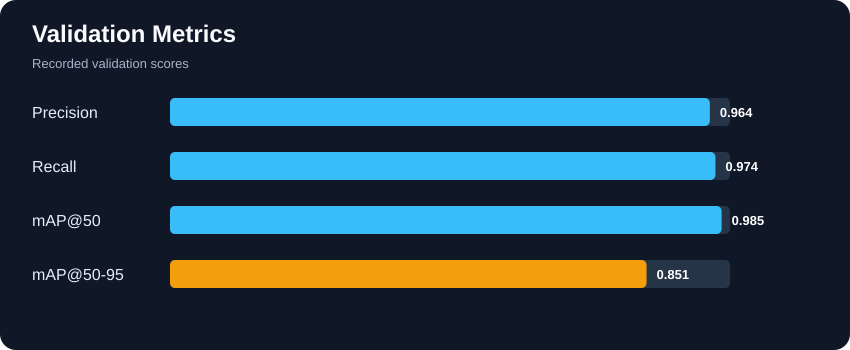
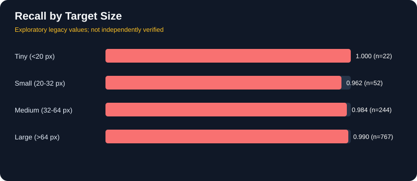
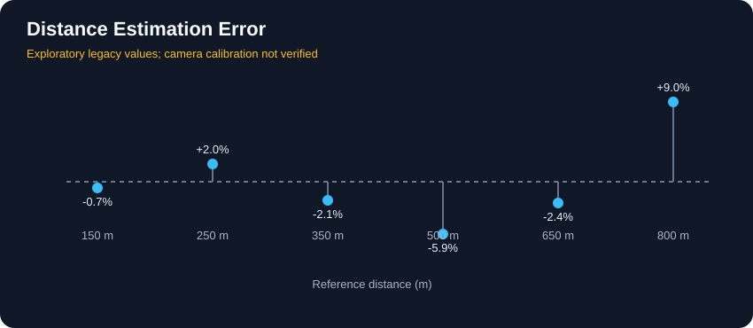

# 🎈 Red-Balloon-Tracker

**تشخیص و رهگیری بالن قرمز کوچک در تصاویر دوربرد**

این پروژه با Python، OpenCV و مدل YOLO برای تشخیص هدف‌های کوچک در تصاویر با وضوح بالا توسعه داده شده است. راهکار اصلی، تقسیم فریم به کاشی‌های هم‌پوشان است تا جزئیات هدف هنگام پردازش حفظ شود.

## معرفی

سناریوی هدف، تشخیص بالن قرمز با قطر تقریبی ۱٫۵ متر از فاصله حدود ۵۰۰ متر با دوربین Sony IMX477 و وضوح 4056×3040 پیکسل است. در این فاصله، هدف بسیار کوچک است و تغییر اندازه کل تصویر می‌تواند جزئیات آن را از بین ببرد.

## قابلیت‌ها

- تشخیص بالن با مدل آموزش‌دیده YOLO26s-p2
- تقسیم فریم به کاشی‌های 640×640 با هم‌پوشانی
- حذف تشخیص‌های تکراری با NMS
- ثبت تشخیص‌ها در CSV
- رهگیری ساده هدف بین فریم‌ها در نسخه تحویل
- فیلتر رنگ و حرکت در اسکریپت‌های آزمایشی
- تخمین فاصله آزمایشی بر اساس اندازه ظاهری هدف و پارامترهای دوربین

## نتایج اعتبارسنجی

| معیار | نتیجه |
|---|---:|
| Precision | **0.964** |
| Recall | **0.974** |
| mAP@50 | **0.985** |
| mAP@50–95 | **0.851** |

این معیارها مربوط به مجموعه اعتبارسنجی هستند و تضمین عملکرد در شرایط واقعی نیستند.

## آزمون سرعت

| مورد | نتیجه |
|---|---:|
| تعداد فریم | 40 |
| وضوح | 4056×3040 |
| کاشی در هر فریم | 48 |
| سرعت ورودی آزمون | 10 FPS |
| سرعت پردازش ثبت‌شده | حدود 5.5 FPS |
| هدف سرعت | 12 FPS |

سرعت فعلی به هدف ۱۲ FPS نرسیده است.

### نمودارهای بنچمارک تکمیلی

> **توجه:** نمودارهای Recall تفکیکی و خطای فاصله از اعداد موجود در اسکریپت قدیمی بنچمارک ساخته شده‌اند. چون هنوز به گزارش بازتولیدپذیر ارزیابی متصل نیستند، صرفاً اکتشافی‌اند و نباید به‌عنوان نتایج نهایی تأییدشده تلقی شوند.

## ساختار مخزن

~~~text
Red-Balloon-Tracker/
├── assets/
├── data_prep/
├── delivery/
│   ├── best.pt
│   ├── dataset_documentation.xlsx
│   ├── final_inference.py
│   ├── requirements.txt
│   └── README.md
├── evaluation/
├── inference/
├── training/
├── experiments/
├── .gitignore
├── LICENSE
└── README.md
~~~

داده‌های خام، ویدئوهای آزمایشی، محیط مجازی و خروجی‌های موقت محلی هستند و نباید به مخزن اضافه شوند.

## نصب (Windows PowerShell)

~~~powershell
git clone https://github.com/Mamad-MD/Red-Balloon-Tracker.git
cd Red-Balloon-Tracker
python -m venv .venv
.\.venv\Scripts\Activate.ps1
python -m pip install --upgrade pip
python -m pip install -r .\delivery\requirements.txt
~~~

PyTorch باید متناسب با سیستم و نسخه CUDA مورد استفاده نصب شود.

## اجرای تشخیص روی ویدئو

مسیر ویدئو را با فایل خودتان جایگزین کنید:

~~~powershell
python .\delivery\final_inference.py `
  --source "C:\path\to\input.mp4" `
  --model ".\delivery\best.pt" `
  --output-video ".\delivery\output\result_video.mp4" `
  --output-csv ".\delivery\output\detections_log.csv"
~~~

برای گزینه‌ها و جزئیات بیشتر، [راهنمای نسخه تحویل](delivery/README.md) را ببینید.

## فایل‌های اصلی تحویل

| فایل | کاربرد |
|---|---|
| [final_inference.py](delivery/final_inference.py) | اجرای تشخیص و رهگیری |
| [best.pt](delivery/best.pt) | وزن مدل |
| [requirements.txt](delivery/requirements.txt) | وابستگی‌های اجرا |
| [dataset_documentation.xlsx](delivery/dataset_documentation.xlsx) | مستندات داده |
| [راهنمای تحویل](delivery/README.md) | روش اجرا |

## محدودیت‌ها

- هنوز ویدئوی واقعی ثبت‌شده با دوربین هدف IMX477 برای ارزیابی نهایی موجود نیست.
- سرعت ثبت‌شده پایین‌تر از هدف ۱۲ FPS است.
- تخمین فاصله بدون کالیبراسیون واقعی دوربین قابل اتکا برای اندازه‌گیری عملیاتی نیست.
- عملکرد در شرایط نور و پس‌زمینه متفاوت باید با داده واقعی بررسی شود.

## فناوری‌ها

Python · PyTorch · Ultralytics · YOLO26s-p2 · OpenCV · NumPy · Pandas

## مجوز

مجوز پروژه در فایل [LICENSE](LICENSE) مشخص شده است.

## مشارکت

برای گزارش مشکل یا پیشنهاد، از [Issues](https://github.com/Mamad-MD/Red-Balloon-Tracker/issues) استفاده کنید.
